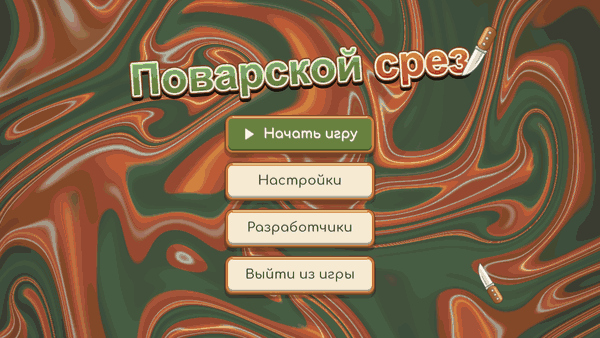
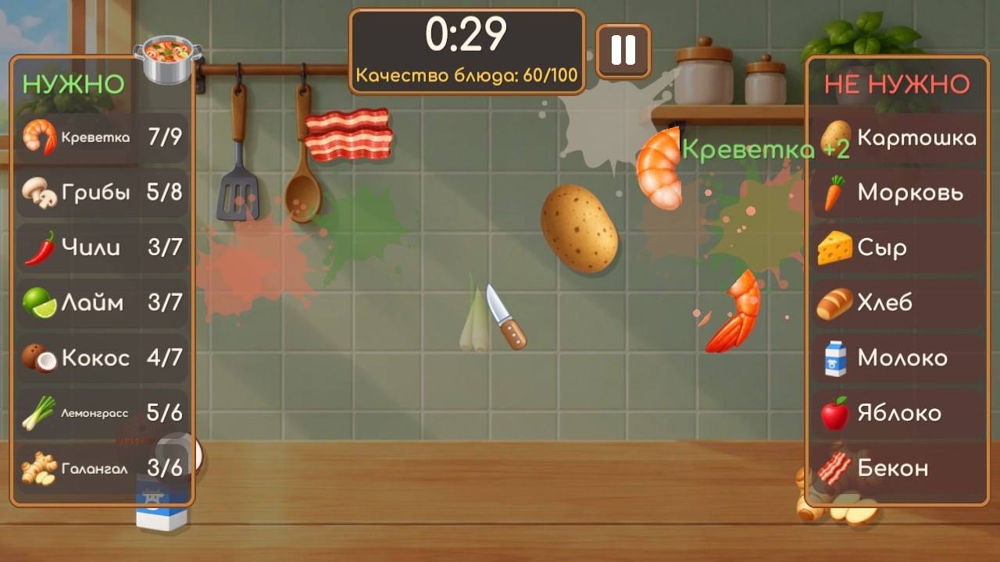
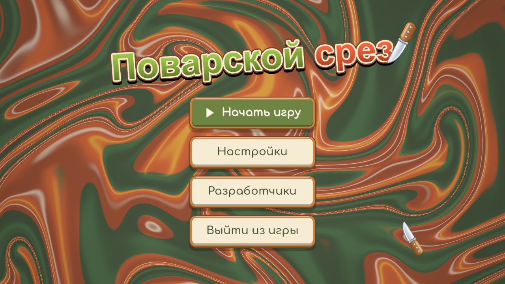
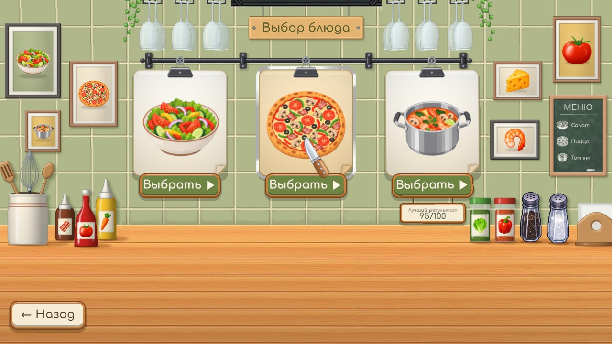
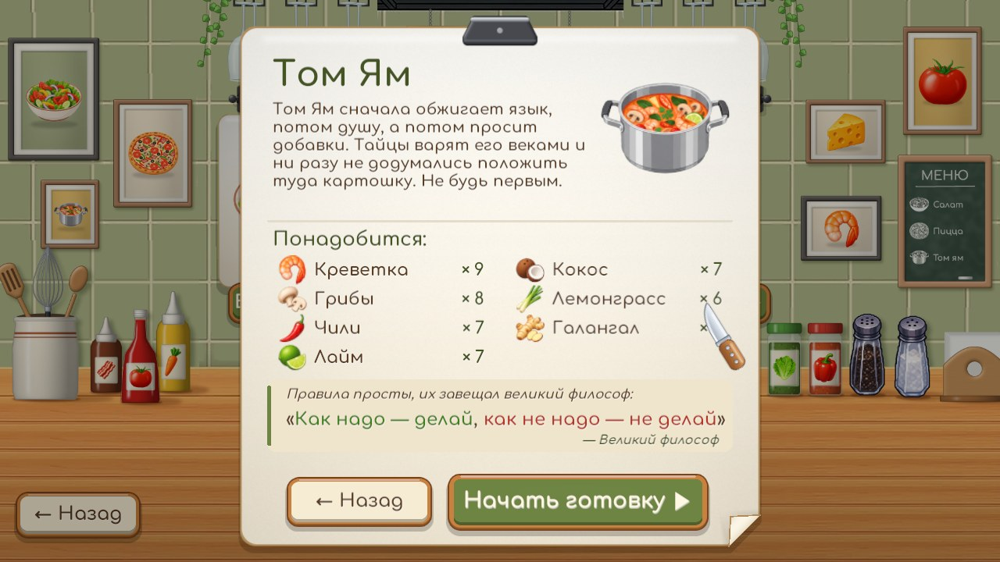
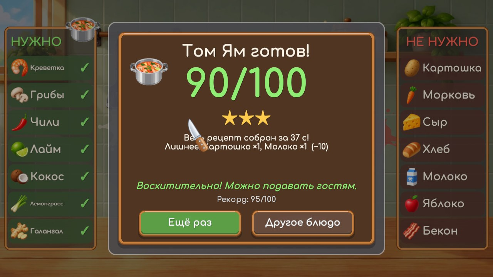

<div align="center">

# 🔪 ПОВАРСКОЙ СРЕЗ
### — КУХНЯ НЕ ПРОЩАЕТ —

**Аркадная нарезка, в которой важно не только что режешь, но и что *не* режешь.**
Собери салат, пиццу или том ям за минуту и не урони в кастрюлю носок.

[](#)
[](#как-запустить)
[](https://unity.com)



</div>

---

## 🍳 О чём игра

> *Тайцы варят том ям веками и ни разу не додумались положить туда картошку.*
>
> *Не будь первым.*
>
> — с листа рецепта

Ингредиенты летят со всех сторон, но резать можно не всё подряд, а только то, что есть в рецепте. Лишнее портит блюдо, перебор тоже. На всё про всё **60 секунд**.

Игра сделана для FunFlow Game Jam × ТПУ.

<div align="center">

</div>

## 📋 Меню дня

| | Блюдо | Сложность | Что нужно |
|:-:|---|:-:|---|
| 🥗 | **Салат** | ★☆☆ | помидор, огурец, салат, лук, перец |
| 🍕 | **Пицца** | ★★☆ | сыр, помидор, грибы, бекон, оливки, перец |
| 🍲 | **Том Ям** | ★★★ | креветка, грибы, чили, лайм, кокос, лемонграсс, галангал |

Вместе с нужным летит лишнее: 🍩 🧦 🍍 🍓 🥔 🐟 и ещё десяток подстав. Полный список есть в [INGREDIENTS.md](Docs/INGREDIENTS.md).

> 🍍 Ананас в пицце? Подумай.

Заказ выбирают на доске: лист снимается с прищепки и разворачивается в рецепт со списком ингредиентов. Под каждым листом висит табличка с лучшим результатом — она появляется после первого приготовленного блюда.

## ⚔️ Как играть

| | Что разрезал | Что будет |
|:-:|---|---|
| 🟢 | **Нужный** ингредиент | Он идёт в блюдо, счётчик в рецепте растёт, на стене остаётся клякса сока |
| 🟡 | Нужный, но **уже хватает** | Перебор: «Уже хватит!» и небольшой штраф |
| 🔴 | **Лишний** ингредиент | Блюдо портится, экран трясётся, шеф недоволен |

> ↔️ Ближе к концу раунда прилетают **встречные**: два ингредиента с разных сторон летят навстречу и пересекаются в центре. Часто один из них лишний — режь до встречи или после.

Собрал весь рецепт до конца минуты — **«Блюдо готово!»**. Не успел — **«Время вышло!»**.

### ✨ Бонусы

Иногда среди ингредиентов пролетает редкий **бонус** в сияющем ореоле. Разрежь его — время на миг замирает, бонус взрывается искрами, соседние ингредиенты разлетаются, а в полосе **«Бонусы»** внизу экрана появляется заряд способности (до двух на каждую):

| | Способность | Клавиша | Что делает |
|:-:|---|:-:|---|
| ⏳ | **Замедление** | **Q** | 5 секунд всё летит вдвое медленнее (и таймер тоже) |
| 🪙 | **Очки ×2** | **W** | 8 секунд нужные ингредиенты и комбо дают двойные очки |
| 🛡️ | **Щит** | **E** | 6 секунд нож проходит сквозь лишнее и перебор — без штрафа |

Применить заряд можно клавишей или кликом по слоту.

### Очки

| Действие | Очки |
|---|---:|
| Нужный ингредиент | **+2** |
| Перебор | **−4** |
| Лишний ингредиент | **−5** |
| 🔥 Комбо: 3+ нужных одним движением | **+5** за каждый после второго |

В каждом рецепте **50 ингредиентов**, поэтому идеальная нарезка даёт ровно **100**. С комбо можно набрать больше, и это уже **«божественное блюдо»** ✨

Звёзды: ★ от 40 · ★★ от 70 · ★★★ от 90. Рекорд засчитывается только за готовое блюдо.

## 🎮 Управление

| Действие | Клавиша |
|---|---|
| Резать | зажать **ЛКМ** и провести по ингредиенту |
| Выбрать блюдо | **1** / **2** / **3** (первое нажатие — рецепт, второе — готовить) |
| Способности | **Q** / **W** / **E** или клик по слоту в полосе «Бонусы» |
| Заново | **R** |
| Пауза / назад | **Esc** или кнопка паузы |
| Двигать ползунки | **←** / **→** или **+** / **−** |

Все клавиши можно переназначить: **Настройки → Горячие клавиши** (из главного меню или из паузы). Там же — громкость (общая, музыка, эффекты), разрешение, режим окна и яркость. Изменения действуют сразу, а запоминаются кнопкой **«Сохранить»**; **«Назад»** без сохранения всё возвращает, **«Сбросить»** ставит значения по умолчанию.

<details>
<summary>🤫 Секрет для шефа</summary>

Во время раунда набери **↑ ↑ ↓ ↓ ← → ← → B A** — блюдо сразу будет готово на 100/100. В рекорды такой результат не попадает.

</details>

## 🖼️ Галерея

<div align="center">
 
 
</div>

## 🛠️ Для разработчиков

### Как запустить

1. Установи **Unity 6000.6.5f1** через Unity Hub. Подойдёт любая 6000.6.x.
2. Склонируй репозиторий:
   ```bash
   git clone https://github.com/t1mohay/funflow.git
   ```
3. В Unity Hub выбери **Add → Add project from disk**, затем папку репозитория.
4. Открой `Assets/Scenes/SampleScene` и нажми **▶ Play**.

Первое открытие занимает пару минут, пока Unity импортирует пакеты.

### Сборка под Windows

Через меню: **File → Build Profiles → Windows → Build**. Через консоль (проект при этом должен быть закрыт в редакторе):

```bash
Unity -batchmode -quit -projectPath . -executeMethod BuildPlayer.Windows -out Build/Game.exe
```

### Устройство проекта

```
Assets/
├─ Scenes/SampleScene.unity   единственная сцена, всё собирается из кода
├─ Scripts/                   GameManager, RoundState (очки), Recipes, Spawner, GameUI…
│  └─ Dev/                    автотест и запись трейлера
├─ Editor/                    сборка и настройки импорта спрайтов
└─ Resources/                 картинки, звуки, шрифт, шейдеры
Docs/                         дизайн-документ, ингредиенты, звук, лицензии, скриншоты
Reserve/                      запасные стили картинок и звуки (в сборку не входят)
Tools/
├─ ArtGen/                    скрипты, которые рисуют бумагу, нож, доску заказов и стену кухни
├─ AudioGen/                  синтез звуков и музыки (Python, numpy, scipy)
├─ Background/                исходник фона кухни
└─ Trailer/                   монтаж трейлера в GIF
```

Стену доски заказов рисует `Tools/ArtGen/kitchen_wall` (`python clean.py && python build.py`, нужны numpy, Pillow и OpenCV). Табличка, бокалы и плющ сохраняются отдельными слоями, и игра их покачивает.

### 🎵 Звук

Стиль — ночной R&B и нео-соул в ля миноре, 86 BPM: все эффекты попадают в гармонию с музыкой. Почти все звуки синтезированы скриптами без сэмплов; музыка раунда — трек команды, ветер взмаха — обработанная запись. Подробности в [AUDIO.md](Docs/AUDIO.md) и [Tools/AudioGen](Tools/AudioGen/README.md).

### 🎬 Трейлер

Трейлер записывает сама игра: `Game.exe -screen-fullscreen 0 -screen-width 1280 -screen-height 720 -trailer <папка>` — бот проходит меню, выбирает том ям и готовит его. [make_trailer.py](Tools/Trailer/make_trailer.py) монтирует кадры в GIF:

```bash
python Tools/Trailer/make_trailer.py <папка> Docs/trailer.gif
```

### 📚 Документы

[Дизайн-документ](Docs/GDD.md) · [Ингредиенты](Docs/INGREDIENTS.md) · [Звук](Docs/AUDIO.md) · [Лицензии](Docs/CREDITS.md)

---

<div align="center">

**Команда**

| Роль | Кто |
|---|---|
| Геймдизайн механик и код | Юрьев Тимофей · Клименко Станислав · Макурин Артём |
| Иллюстрации и оформление | Лушников Дмитрий |
| Звуковое сопровождение и пользовательский интерфейс | Миков Кирилл |

<sub>Шрифт Comfortaa (SIL OFL 1.1) · Noto Emoji (Apache 2.0) · подробности в <a href="Docs/CREDITS.md">CREDITS</a></sub>

<sub>Сделано за 4 дня на FunFlow Game Jam × ТПУ · 10–14 октября 2026</sub>

🔪🍅🥒🧅

</div>
