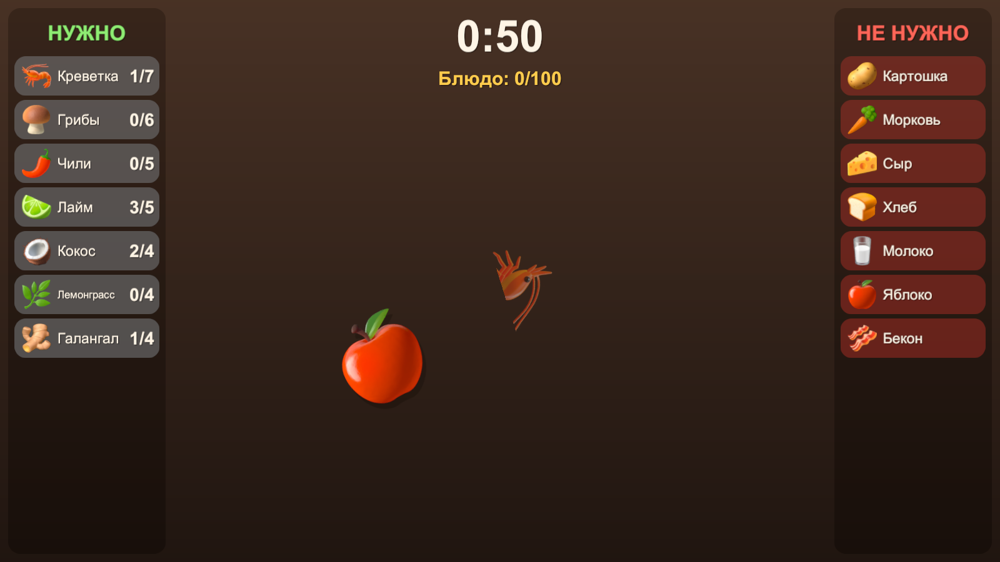

# Режь по рецепту!

Игра для FunFlow Game Jam × ТПУ, вариант 3 «Разруби!» (по мотивам Fruit Ninja).

Выбери блюдо — салат, пиццу или том ям — и за минуту нарежь все ингредиенты из рецепта.
Режь только то, что в списке «НУЖНО»: картошка в том яме испортит оценку.

## Как запустить

1. Установить **Unity 6.6** (6000.6.x) через Unity Hub.
2. Скачать репозиторий (`git clone` или Code → Download ZIP).
3. Unity Hub → **Add → Add project from disk** → выбрать папку репозитория.
4. Открыть сцену `Assets/Scenes/SampleScene` и нажать **Play**.

Первое открытие занимает пару минут: Unity импортирует пакеты.

## Управление

- Зажать левую кнопку мыши и провести по ингредиенту — разрезать.
- **1 / 2 / 3** — выбор блюда в меню, **R** — заново, **Esc** — в меню.

## Правила

- Нужный ингредиент — **+2**, лишний (из списка «НЕ НУЖНО») — **−3**, перебор сверх нормы — **−3**.
- В каждом рецепте 50 ингредиентов: весь рецепт без ошибок = **100**.
- **Комбо:** 3+ нужных одним движением — бонус. Больше 100 — «божественное блюдо».
- Собрал весь рецепт за 60 секунд — победа. Не успел — проигрыш.

## Документы

- [Дизайн-документ](Docs/GDD.md)
- [Список ингредиентов](Docs/INGREDIENTS.md)
- [Звук и музыка](Docs/AUDIO.md)
- [Сторонние ресурсы и лицензии](Docs/CREDITS.md)
